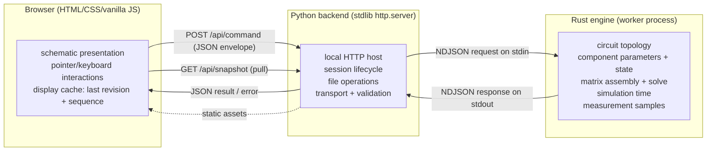
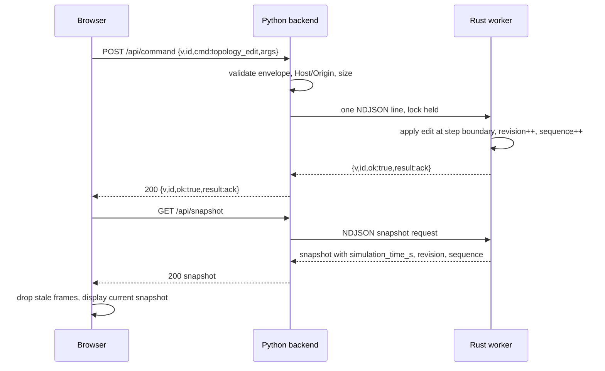

# Task 02 — Architecture and interface contracts

Status: complete (2026-11-26). Depends on [Task 01](reference-analysis.md). Machine-readable contract: [interface-schema.json](interface-schema.json). Verification script: [`tests/smoke.py`](../tests/smoke.py).

This document freezes the boundaries, transport and data contracts for the first implementation slice. Task 03 has since added a dense MNA solver (topology, stamping, LU, trapezoidal transients, diode iteration); see [solver-algorithms.md](solver-algorithms.md) and [numerical-validation.md](numerical-validation.md). The interface contract below is unchanged.

## 1. Decisions at a glance

| Decision | Choice | Alternative rejected |
|---|---|---|
| Rust/Python boundary | Persistent Rust worker process with newline-delimited JSON over stdin/stdout | PyO3/maturin extension (not implemented) |
| Python HTTP layer | `http.server.ThreadingHTTPServer`, stdlib only, loopback bind | Third-party framework + WebSocket server |
| Browser | Static HTML/CSS/vanilla JS; snapshot pull via `POST /api/command` (`cmd: "snapshot"`) while running | Heavy frontend framework / persistent socket in MVP |
| Wire format | Versioned JSON envelopes, `v: 1` | Unversioned line protocol (previous scaffold) |
| Edit safety | Monotonic `revision`, `base_revision` required for edits, stale edits rejected | Last-write-wins mutation |
| Frame safety | Monotonic `sequence`, consumers drop `sequence <= last seen` | Applying every queued snapshot |
| Rust dependencies | None (small local JSON parser/serializer) | `serde`/`serde_json` (deferred) |

Only one bridge is implemented. PyO3 is documented as a rejected alternative, not partially built.

## 2. Ownership diagram





### Ownership rules

| State | Owner | Notes |
|---|---|---|
| Circuit topology, element IDs, node IDs, parameters, dynamic model state | Rust `Engine` | Single writable copy; Python/browser only hold IDs and display values |
| Matrix, RHS, LU factors, iteration counters, `t`, `timeStep` | Rust (dense solver implemented in Task 03) | Never serialized into Python state |
| Revision counter, snapshot sequence counter | Rust | Authoritative; Python/browser cache them only for validation |
| Session lifecycle, worker process, request ids, file paths | Python | One session per worker process |
| Last applied revision/sequence, camera/zoom, widget state | Browser | Display cache; never authoritative |
| Wall-clock frame cadence | Browser/Python | Python driver ticks every 16 ms while `running`, issuing bounded `step` commands; browser polls snapshots every 50 ms. Neither cadence is physics time. |

**No duplicate solver state.** Python does not recompute voltages or currents; JavaScript does not solve circuits. Task 01 showed the reference solvers own `nodeVoltages`, `circuitMatrix`, `circuitNonLinear` and `t` inside `CirSim`/`SimulationManager`; the Rust engine will own the equivalents.

## 3. Rust/Python boundary rationale

The Task 01 analysis found a coarse-grained seam: `SimulationManager.analyzeCircuit → preStampCircuit → stampCircuit → runCircuit → onTimeStep`. Those are whole-circuit operations, so a process boundary costs one message per user action or display snapshot, not one message per matrix stamp.

| Criterion | Persistent worker (chosen) | PyO3/maturin extension |
|---|---|---|
| GIL release | Not applicable; Python blocks on `readline` while Rust runs in its own process | Requires explicit `py.allow_threads` around every long call |
| Cancellation | Terminate the process; session dies cleanly and can be restarted | Hard to interrupt a running native call safely |
| Crash isolation | Worker crash becomes `503 engine_unavailable`; HTTP server survives | Native panic can take down the interpreter |
| Build complexity | `cargo build` produces one executable; no Python ABI matching | Needs maturin, per-version wheels, ABI management |
| Data copies | One JSON encode/decode per command and snapshot; payloads are small (IDs, scalars, bounded sample arrays) | Zero-copy possible in principle, but requires careful ownership/GIL discipline |
| Debuggability | Protocol is inspectable line-by-line; worker can be run standalone | Requires native debugging tooling |

Trade-off accepted: per-message JSON overhead and process startup. This is acceptable while snapshots are pulled at UI cadence and edits are rare. If profiling (Task 09) shows the boundary dominates, a PyO3 extension can replace the worker behind the same command schema; the schema, not the transport, is the stable contract.

## 4. Transport and concurrency

- Framing: one UTF-8 JSON object per line on worker stdin/stdout. Blank lines ignored.
- One request in flight per worker; `EngineClient` serializes access with an `RLock`, so HTTP handler threads cannot interleave writes.
- Request envelope: `{v:1, id, cmd, args}`; response: `{v:1, id, ok, result}` or `{v:1, id, ok:false, error:{code,message,retryable}}`.
- Request size ≤ 1 MiB; response size ≤ 4 MiB; command `id` ≤ 128 chars; `steps` ≤ 10,000; subscribed signals ≤ 64.
- Reliable messages: successful edits carry `id` and the new `revision`; errors carry `id`, `code`, `message` and `retryable` (no revision, since an error may occur before a circuit exists). Snapshots are replaceable and may be coalesced.
- Replaceable frames: snapshots carry `sequence`; clients drop frames with `sequence <= last seen`. In the MVP snapshots are pulled, so no queue can grow; a future streaming subscription will use a bounded ring buffer (planned 4096 samples/signal, latest wins).
- Safe edit boundaries: the worker handles one command at a time and applies edits only between simulation steps. `base_revision` is mandatory for `topology_edit`/`parameter_edit` and optional for control commands; mismatches return `stale_revision`.
- Time separation: `simulation_time_s` advances only via `step` (currently) or solver stepping (Task 03). Wall-clock timers in the browser drive display only.
- Shutdown: `shutdown` command returns an ack, then the worker exits; Python waits up to 2 s, then terminates/kills it.

## 5. Interface contract summary

Full schema, including per-command argument validation and examples, is in [interface-schema.json](interface-schema.json).

| Command | Required args | Result |
|---|---|---|
| `hello` | — | `engine_version`, `protocol`, `capabilities` |
| `create` | — (`circuit_id` optional) | `ack` with revision 1 |
| `load_circuit` | `dump`, `format` (`text`/`xml`), optional `base_revision` | `ack` |
| `topology_edit` | `base_revision`, `ops[]` (`add`/`remove`/`connect`/`disconnect`, `element_id`, optional `kind`/`node_ids`) | `ack` |
| `parameter_edit` | `base_revision`, `element_id`, `params` (SI-unit keys) | `ack` |
| `reset` | optional `base_revision` | `ack` |
| `run` / `pause` | optional `base_revision` | `ack` |
| `step` | `dt_s` in (0, 1], optional `steps` in [1, 10000] | `ack` |
| `subscribe` | `stream_id`, `signals[]` (`id`, `element_id`, `quantity`, `unit`) | `ack` |
| `unsubscribe` | `stream_id` | `ack` |
| `snapshot` | — | `snapshot` object |
| `shutdown` | — | `ack`, then worker exits |

Error codes: `unsupported_version`, `bad_request`, `unknown_command`, `stale_revision`, `unknown_element`, `unknown_stream`, `bad_document`, `invalid_document`, `no_document`, `session_lost`, `host_not_allowed`, `not_found`, `invalid_request_size`, `engine_unavailable`, `internal_error`.

Units: protocol values are SI base units with explicit suffixes in keys/fields — `dt_s`, `simulation_time_s`, `time_step_s`, `voltage_v`, `resistance_ohm`, `capacitance_f`, measurement `unit` of `V`/`A`. Display formatting (mV, µs, kΩ) belongs to the browser.

Example request/response:

```json
{"v":1,"id":"cmd-4","cmd":"step","args":{"dt_s":5e-6,"steps":100}}
```

```json
{"v":1,"id":"cmd-4","ok":true,"result":{"type":"ack","circuit_id":"circ-smoke","revision":3,"sequence":8}}
```

```json
{"v":1,"id":"cmd-5","cmd":"snapshot","args":{}}
```

```json
{"v":1,"id":"cmd-5","ok":true,"result":{"type":"snapshot","circuit_id":"circ-smoke","revision":3,"sequence":8,"simulation_time_s":0.0005,"time_step_s":0.000005,"running":false,"status":"ready","nodes":[{"id":"n0","voltage_v":0.0},{"id":"n1","voltage_v":0.0}],"measurements":[{"id":"vout","element_id":"r1","quantity":"voltage","value":0.0,"unit":"V"}],"diagnostics":[]}}
```

Stale edit example:

```json
{"v":1,"id":"cmd-6","ok":false,"error":{"code":"stale_revision","message":"expected revision 3, got 2","retryable":false}}
```

HTTP mapping: `/api/command` validates the envelope fields (`v`, `id`, `cmd`, `args`) and preserves its `id`; engine errors with client codes map to HTTP 400, engine failure and session loss to 503. `GET /api/health` calls `hello`; `GET /api/snapshot` returns a snapshot pulled from the worker. Static files are served from `web/` with a path-traversal guard. `Host` must be loopback; if `Origin` is present it must also be loopback HTTP. Request bodies are capped at 1 MiB.

## 6. Project layout

```
Cargo.toml              workspace root (member: engine)
engine/
  Cargo.toml            electrow-engine crate (lib + worker binary, no dependencies)
  src/lib.rs            protocol version, Engine state machine, command handlers, tests
  src/json.rs           minimal JSON value, parser, serializer, tests
  src/main.rs           NDJSON worker loop
backend/
  __init__.py, __main__.py
  engine_client.py      worker lifecycle, NDJSON request/response, id correlation
  server.py             loopback HTTP host, validation, static assets
web/
  index.html, app.js, style.css
tests/
  smoke.py              real Rust worker + HTTP round trip
Docs/
  reference-analysis.md, source-inventory.json
  architecture.md, interface-schema.json
ref_SEVA77/, ref_Vactrol/, ref_LVLabs/   read-only; never packaged or imported implicitly
```

Run commands:

```powershell
./checkreqs.ps1
cargo test --workspace
cargo build --workspace
python tests/smoke.py
python -m backend
```

The browser then opens at `http://127.0.0.1:8000/`. `ELECTROW_ENGINE` overrides the worker path (useful for release binaries).

## 7. Dependency choices

- **Rust: std only.** The protocol is small enough for a local JSON parser (~250 lines) and avoids a network-dependent build. `serde_json` is the likely future upgrade when schemas grow; it would not change the wire contract.
- **Python: stdlib `http.server`.** No pip dependencies; `ThreadingHTTPServer` isolates blocking `readline` per request while the `RLock` protects the single worker. Adequate for loopback MVP. If remote hosting is ever required, revisit before adding features.
- **No WebSocket yet.** Task 02 permits one if needed; pull snapshots at display cadence are sufficient for a contract spike and keep the surface small. A future `subscribe` stream can be exposed over WebSocket/SSE without changing command semantics.
- **JS: vanilla ES modules later.** Current `app.js` uses plain functions and `fetch`; no build step or framework. Rendering choices (Canvas 2D vs SVG) are deferred to Task 07.

## 8. Failure handling

| Failure | Behavior |
|---|---|
| Worker not built / wrong path | `/api/health` and commands return 503 with `engine_unavailable` text |
| Worker exits mid-request | Python raises `RuntimeError`; HTTP returns 503, session can be restarted |
| Malformed JSON line from worker | Python raises protocol error; HTTP 503 |
| Invalid HTTP envelope | HTTP 400 with error text; worker never sees it |
| Stale revision | Engine returns `stale_revision`; HTTP 400; browser must refresh revision before retrying |
| Foreign `Host`/`Origin` | HTTP 403 |
| Request > 1 MiB | HTTP 413 |
| `shutdown` | Ack, worker exits, Python waits then terminates/kills |

## 9. Verification evidence (2026-11-26)

| Check | Command | Result |
|---|---|---|
| Toolchain | `./checkreqs.ps1` | cargo 1.100.0, rustc 1.100.0, Python 3.12.6 OK |
| Rust protocol/state tests | `cargo test --workspace` | 91 passed, 0 failed (solver fixtures, circuit documents, Falstad/XML import, JSON protocol, revision enforcement, step/sequence, subscriptions, shutdown) |
| Rust binary | `cargo build --workspace` | built `target/debug/electrow-engine.exe` |
| Real worker + HTTP round trip | `python tests/smoke.py` | `SMOKE OK`: hello, create, edits, stale rejection, subscribe, step, snapshot, run/pause/reset, static assets, health, 400/403 mapping |
| Python syntax | `python -m compileall -q backend tests` | pass |
| Browser script syntax | `node --check web/app.js` | pass |
| Browser behavior | Manual UI check | Not automated (no headless browser in this environment); static assets and the same API calls were exercised over HTTP by the smoke test |

Known limitation: the solver supports resistors, ideal sources, switches, capacitors, inductors, diodes, wires and ground, plus simplified BJTs and MOSFETs (no body diodes or saturation models). Controlled sources, op-amps and digital models are deferred. Circuit JSON, Falstad text and XML import are implemented (Task 05); browser schematic editing and scopes remain in Task 07.

## 10. Deferred decisions

1. Sparse strategy: dense MNA is implemented; choose a sparse path from measured circuit sizes (Task 09, informed by Task 01's `SPARSE_THRESHOLD = 150`).
2. Nonlinear convergence rule: global `subIterations` (SEVA77) vs per-element `localSubIters` (Vactrol/LVLabs).
3. Streaming measurements: bounded ring buffer and WebSocket/SSE delivery when scope UI needs continuous samples.
4. Persistence: `text` vs `xml` circuit loaders and fixture corpus (Task 05).
5. Session model: multiple concurrent circuits/workers, cancellation tokens and reconnection (Task 06).

## 11. Acceptance checklist

- [x] Ownership diagram and ownership table written.
- [x] API examples and machine-readable schema for all required commands, IDs, revisions, units, errors and snapshots.
- [x] Dependency choices and rationale, including rejected PyO3 alternative; only one bridge implemented.
- [x] Minimum Rust/Python/browser round trip verified with the real worker over HTTP.
- [x] No duplicate solver state; Python and browser own only transport/session/display data.
- [x] Reference folders untouched.
